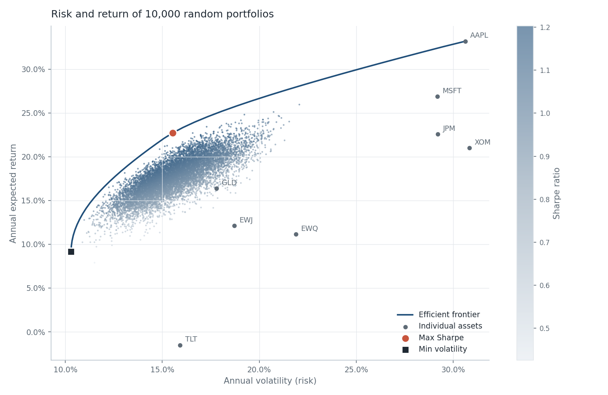

# Portfolio Optimization & Risk-Return Dashboard

A Python project applying **Modern Portfolio Theory** (Markowitz, 1952) to real market data, with an interactive Streamlit dashboard and an **AI risk analyst** powered by Claude.



## What it does

1. **Retrieves and cleans** daily adjusted prices for a diversified global portfolio (US equities, France and Japan equity ETFs, long-term US Treasuries, gold) from Yahoo Finance.
2. **Computes** annualised returns, volatility, covariance, correlations, Sharpe ratios and maximum drawdowns.
3. **Simulates 10,000 random portfolios** (vectorised Monte Carlo) to map the risk-return space.
4. **Optimises** with SciPy (SLSQP) to find the **maximum-Sharpe** and **minimum-volatility** portfolios and trace the **efficient frontier**, with an optional cap on the weight of any single asset.
5. **Explains the results with AI**: Claude reads the statistics and writes a critical review of what drives the allocation and where the risks lie (concentration, drawdowns, reliance on past data). A rule-based summary is used if no API key is provided.

## Results

Daily data from January 2019 to October 2026 (1,956 trading days), risk-free rate 3%.

| Portfolio | Annual return | Volatility | Sharpe | Main holdings |
|---|---|---|---|---|
| **Max Sharpe** | 22.7% | 15.5% | **1.27** | Gold 47%, Apple 26%, Microsoft 9%, Exxon 9%, JPMorgan 9% |
| **Min volatility** | 9.2% | 10.3% | 0.60 | US Treasuries 47%, Gold 20%, Japan 10%, Exxon 9%, JPMorgan 9% |
| Best single asset (Apple) | 33.2% | 30.6% | 0.99 | - |

**Key observations**

- **Diversification works:** the max-Sharpe portfolio reaches a Sharpe ratio of 1.27, higher than any individual asset (best: Apple at 0.99), with half of Apple's volatility.
- **Gold is the anchor of the optimal portfolio (47%)**: solid returns over the period, moderate volatility and low correlation with equities.
- **Long-term Treasuries (TLT) lost money (-1.5%/year, -48% drawdown)** because of the 2022 rate hikes, yet they are the largest holding of the min-volatility portfolio: that optimisation looks only at risk and correlations, not at returns.
- **France and Japan ETFs get zero weight in the max-Sharpe portfolio**, illustrating how mean-variance optimisation concentrates on past winners. Capping the weight per asset in the dashboard produces a more balanced allocation.

## Project structure

```
├── app.py              # Streamlit dashboard
├── main.py             # command-line version, saves charts to outputs/
├── src/
│   ├── config.py       # tickers, dates, risk-free rate, settings
│   ├── data.py         # download + cleaning
│   ├── metrics.py      # returns, volatility, Sharpe, drawdown
│   ├── optimizer.py    # Monte Carlo, max Sharpe, min vol, efficient frontier
│   ├── pipeline.py     # runs all steps in order
│   ├── ai_analyst.py   # Claude-powered risk review
│   └── charts.py       # matplotlib figures
└── tests/test_core.py  # unit tests for the maths
```

## Getting started

```bash
git clone https://github.com/<your-username>/portfolio-optimization-dashboard.git
cd portfolio-optimization-dashboard
python3 -m venv .venv && source .venv/bin/activate
pip install -r requirements.txt

python main.py          # analysis in the terminal + charts in outputs/
streamlit run app.py    # interactive dashboard
pytest                  # run the tests
```

To enable the AI review, set your Anthropic API key (or paste it in the dashboard):

```bash
export ANTHROPIC_API_KEY="your-key"
python main.py --ai
```

## Methodology and limitations

- **Expected returns are historical averages.** They are a noisy estimate of future returns, and the optimiser is very sensitive to them; this is why a weight cap is available.
- **Long-only, no leverage**, weights sum to 100%. No transaction costs or rebalancing.
- **All assets are priced in USD**, so returns are comparable without currency effects.
- **Volatility is treated as the measure of risk**, which assumes roughly symmetric returns; maximum drawdown is reported as a complement.
- **The backtest chart is in-sample**: weights are chosen on the same data used to evaluate them, so it overstates real-world performance.

## Next steps

- Out-of-sample backtest with periodic rebalancing (walk-forward)
- More robust estimates: Ledoit-Wolf covariance shrinkage, Black-Litterman returns
- Alternative risk measures: CVaR / Expected Shortfall
- Deploy the dashboard on Streamlit Community Cloud

## Tech stack

Python · pandas · NumPy · SciPy · matplotlib · Streamlit · yfinance · Anthropic API · pytest

---
*Educational project. Nothing here is investment advice.*
